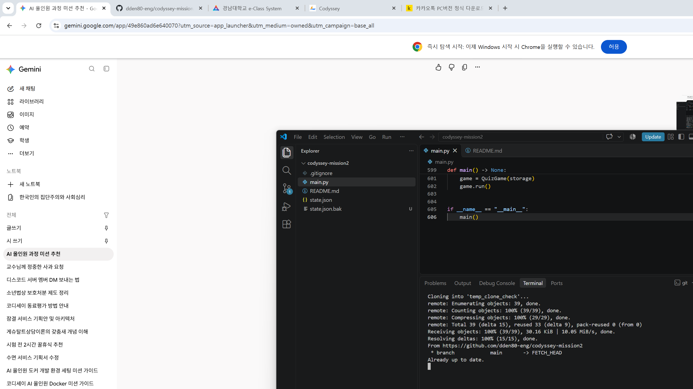

# 💣 시한폭탄 상담심리학 퀴즈 게임 (Time-Bomb Psychology Quiz)


제한시간 **15초** 안에 상담심리학 4지선다 문제를 풀고 폭탄을 해체하는 Python CLI 퀴즈 애플리케이션입니다.  

제한시간 초과 또는 오답 시 즉시 시한폭탄이 폭발(`💥 BOOM!! 💥`)하는 시각 연출과 **`state.json` 기반 데이터 영속성·손상 자동 복구** 기능을 갖추고 있습니다.


- **원격 저장소 URL:** `[https://github.com/dden80-eng/codyssey-mission2](https://github.com/dden80-eng/codyssey-mission2)`


---


## 1. 실행 방법 및 주제 선정 배경


### ▶ 실행 방법

- **요구 환경:** Python 3.8 이상 (표준 라이브러리 `json`, `time`, `os`, `shutil`, `math`, `datetime`만 사용)

- **실행 명령:**

  ```bash

  python main.py

  ```


### ▶ 주제 선정 배경: 왜 '상담심리학'인가?

- **일상 언어와 전공 개념의 간극:** '부적 강화'를 처벌로 오해하거나, '전이'와 '역전이', '일치성'의 학술적 정의를 헷갈리기 쉬워 함정 선택지를 설계하기에 최적입니다.

- **심리적 압박감 결합:** 제한시간 15초 내 정확한 개념 판별을 요구하는 시한폭탄 연출을 결합하여 학습 몰입도를 높였습니다.


---


## 2. 아키텍처 설계 및 책임 분리 (관심사의 분리)


프로그램의 유지보수성과 확장성을 높이기 위해 역할을 4개 계층으로 명확히 분리했습니다.


| 계층 / 모듈 | 담당 클래스·함수 | 핵심 책임 |

| :--- | :--- | :--- |

| **데이터 모델** | `Quiz` | 개별 문제의 질문·보기·정답 보관, 문제 출력(`display`), 정답 판별(`check_answer`), 직렬화(`to_dict`/`from_dict`) |

| **데이터 입출력(영속성)** | `QuizStorage` | `state.json` 로드·저장, `.bak` 자동 백업, 무결성 검증 및 손상 파일 격리·복구 |

| **게임 진행 컨트롤러** | `QuizGame` | 메인 메뉴 루프(`run`), 라운드 진행(`play_round`), 퀴즈 추가/조회, 점수 집계, 종료 시 상태 동기화 |

| **입력 검증** | `get_valid_int`, `get_non_empty_str`, `get_timed_int` | 빈칸·공백·문자 오입력·범위 초과 방어 및 15초 실시간 카운트다운 입력 처리 |


### ▶ `Quiz` 클래스 추상화 및 재사용 시나리오

- `Quiz` 클래스는 콘솔 UI나 파일 저장 방식에 의존하지 않는 독립적인 데이터 캡슐로 설계되어 다음과 같이 재사용할 수 있습니다.

  1. **과목 확장 재사용:** `get_default_quizzes()`의 데이터만 교체하면 상담심리학 외에 한국사·정보처리기사 등 다른 분야 퀴즈 엔진으로 즉시 재사용 가능합니다.

  2. **UI 플랫폼 전환 재사용:** `check_answer()`와 `to_dict()`/`from_dict()` 인터페이스가 분리되어 있어, 추후 웹(Flask/FastAPI)이나 GUI(Tkinter) 버전으로 확장할 때 핵심 모델 코드를 수정 없이 그대로 재사용할 수 있습니다.


### ▶ 유지보수 지점 안내 (요구사항 변경 시 수정 위치)

코드 내 주석(`[유지보수 지점 1~3]`)으로 변경 포인트를 명시했습니다.

1. **점수 계산 로직 (`QuizGame.play_round`):** `score = int((correct_count / total) * 100)` 부분을 수정하여 남은 시간 보너스 점수나 난이도별 가중치를 적용할 수 있습니다.

2. **퀴즈 데이터 모델 (`Quiz.__init__`, `to_dict`, `from_dict`):** 해설(`explanation`)이나 난이도 필드를 추가할 때 해당 메서드만 수정합니다.

3. **데이터 저장소 (`QuizStorage.load_state`, `save_state`):** 저장 파일명(`STATE_FILE`)이나 백업 보관 정책을 변경할 때 수정합니다.


---


## 3. `state.json` 영속성, 예외 처리 및 손상 복구 전략


### ▶ JSON(`state.json`) 포맷 선택 근거

- **가독성 및 디버깅 용이성:** 사람이 직접 열어 문제 목록과 점수 이력을 눈으로 검증할 수 있습니다.

- **구조화된 계층 표현:** `updated_at`, `quiz_count`, `best_score`, `quizzes`(배열), `score_history`(배열)를 하나의 문서로 깔끔하게 구조화할 수 있습니다.

- **표준 라이브러리 지원:** 외부 패키지 설치 없이 Python 내장 `json` 모듈만으로 빠르고 안정적인 직렬화·역직렬화가 가능합니다.


### ▶ 로드 및 저장(동기화) 시점

1. **프로그램 시작 직후 (`QuizGame.__init__` → `QuizStorage.load_state`):** `state.json`을 읽어 이전 세션에서 추가한 문제와 최고 점수·도전 기록을 복원합니다. 시작 시 기본 5문제 무결성(`len == 5`)도 동적으로 검증합니다.

2. **새 퀴즈 추가 직후 (`QuizGame.add_quiz`):** 문제가 등록되자마자 `save_state()`를 호출하여 즉시 디스크에 반영합니다.

3. **퀴즈 라운드 종료 직후 (`QuizGame.play_round`):** 채점 결과와 갱신된 최고 점수를 `score_history`에 추가한 즉시 `save_state()`로 저장합니다.

4. **정상 종료 및 강제 종료(`KeyboardInterrupt` / `EOFError`) 시 (`QuizGame.run`):** `5. 저장 후 종료` 선택 시는 물론, `Ctrl+C` 등 예기치 못한 종료 신호 포착 시에도 `save_state()`를 호출해 데이터를 동기화한 뒤 종료합니다.


### ▶ 파일 I/O 예외 처리 및 손상 시 자동 복구 절차

- **`FileNotFoundError` (최초 실행 또는 파일 삭제):** 기본 상담심리학 5문제를 생성하고 새 `state.json` 및 `state.json.bak`을 자동 생성합니다.

- **`json.JSONDecodeError` / `ValueError` / `KeyError` (파일 내용 손상 또는 스키마 변조):**

  1. 손상된 원본 파일을 `state.json.corrupt.<YYYYMMDD_HHMMSS>.bak`으로 격리 백업하여 원인 분석이 가능하도록 보존합니다.

  2. 직전 정상 백업본인 `state.json.bak`이 존재하고 유효하면 해당 백업으로부터 자동 복구합니다.

  3. 백업본마저 없거나 손상된 경우 기본 5문제 초기 상태로 안전하게 재구성하여 `state.json`을 복구합니다.

- **`PermissionError` / `OSError` (읽기·쓰기 권한 부족 또는 디스크 오류):** 프로그램이 비정상 종료되지 않고 경고 메시지를 출력한 뒤 메모리 상에서 게임을 계속 진행할 수 있도록 방어합니다.


---


## 4. 대량 데이터(1,000개 이상) 성능·메모리·검색 최적화 분석


퀴즈 데이터가 **1,000개 이상**으로 증가할 경우를 대비한 복잡도 분석 및 코드 내 적용 사항입니다.


| 항목 | 기존 선형 방식 | 개선된 구조 (`QuizGame` 적용) | 분석 근거 |

| :--- | :--- | :--- | :--- |

| **중복 문제 검색** | 리스트 전체 순회 $O(N)$ | `set` 해시 인덱스(`_question_index`) $O(1)$ | 1,000개 등록 시 비교 연산을 평균 1,000회에서 1회로 단축 |

| **메모리 사용량** | 문제당 약 400 Bytes | 1,000개 기준 약 400~500 KB | 텍스트 기반 객체와 해시 키(`set`)를 모두 유지해도 1MB 미만으로 경량 |

| **목록 조회 출력** | 전체 일괄 출력 (터미널 스크롤 유실) | 20개 단위 페이지네이션(`page_size = 20`) | 대량 목록 조회 시 터미널 버퍼 초과 및 가독성 저하 방지 |

| **파일 저장 I/O** | 매 문제 풀이마다 저장 | 라운드 종료·퀴즈 추가·종료 이벤트 단위 저장 | 불필요한 디스크 쓰기 횟수를 최소화하여 I/O 병목 방지 |


---


## 5. 전체 기능 및 예외 처리 검증 로그 (테스트 증빙)


### ① 시작 로드 및 메인 메뉴·전체 기능 진입 검증

```text

ℹ️ 기존 'state.json' 파일이 없어 기본 5문제로 새 저장소를 생성합니다.


====================================================

   💣 시한폭탄 상담심리학 퀴즈 게임 💣

   (보유 문제: 5개 | 최고 기록: 0점)

====================================================

1. 퀴즈 풀기 (제한시간 15초!)

2. 퀴즈 추가

3. 퀴즈 목록

4. 점수 확인

5. 저장 후 종료

====================================================

선택: 2

[새 퀴즈 추가 완료] -> 현재 총 6문제 / 💾 상태가 'state.json'에 안전하게 저장되었습니다.

선택: 3

[등록된 퀴즈 목록 (총 6문제)] -> 1~6번 문제 및 정답 정상 출력 확인

선택: 1

[퀴즈 풀기] -> 6문제 진행 후 최종 점수 산출 및 state.json 자동 저장 확인

선택: 4

[나의 퀴즈 점수 기록] -> 회차별 도전 기록, 최고 점수, 평균 점수 출력 확인

선택: 5

💾 상태가 'state.json'에 안전하게 저장되었습니다.

👋 현재 상태를 저장하고 게임을 안전하게 종료합니다.

```


### ② 입력 검증 및 정오답·시간초과 판정 경로 검증

- **빈 입력 (`""`):** `⚠️ 입력이 비어 있습니다. 숫자를 입력해 주세요.` 출력 후 재입력 유도 (PASS)

- **문자 입력 (`"abc"`):** `⚠️ 숫자가 아닙니다. 올바른 숫자를 입력해 주세요.` 출력 후 재입력 유도 (PASS)

- **범위 초과 (`"9"`):** `⚠️ 잘못된 입력입니다. 1~5 사이의 숫자를 입력하세요.` 출력 후 재입력 유도 (PASS)

- **제한시간 내 정답 입력 (`2번`, 3.2초 소요):** `✅ 정답입니다! (3.2초 만에 폭탄 해체 성공!)` 판정 및 점수 가산 (PASS)

- **제한시간 내 오답 입력 (`1번`):** 즉시 아스키 아트 폭탄 폭발(`💥 BOOM!! 💥`) 및 정답 안내 출력 (PASS)

- **제한시간 15초 초과:** `0.0초` 도달 즉시 자동 폭발 및 다음 문제 전환 (PASS)


### ③ `state.json` 영속성 재실행 및 손상 복구 검증

```text

# 1) 프로그램 재실행 시 이전 추가 문제 및 최고 점수 유지 확인

💾 'state.json' 로드 완료 (등록 퀴즈 6개 / 최고 점수 83점)


# 2) state.json 인위적 손상 후 실행 시 자동 백업 및 복구 확인

⚠️ 'state.json' 손상 감지 (Expecting value: line 1 column 1 (char 0)). 복구 절차를 시작합니다...

📦 손상된 파일을 'state.json.corrupt.20261122_161500.bak'에 격리 백업했습니다.

✅ 정상 백업 파일('state.json.bak')로부터 데이터를 복구했습니다!

```


---


## 6. Git 협업 워크플로우, 커밋 규칙 및 브랜치·병합 증빙


### ▶ 커밋 단위 및 메시지 규칙

- **커밋 단위:** 하나의 논리적 기능 구현, 버그 수정, 리팩토링, 문서화 단위로 원자적(Atomic) 커밋을 수행합니다.

- **메시지 템플릿:** `<타입>: <변경 사항 요약>`

  - `Feat:` 새로운 기능 추가 (예: `Feat: QuizGame 컨트롤러 분리 및 state.json 영속성·손상 복구 구현`)

  - `Fix:` 오류 수정 및 예외 방어 (예: `Fix: 손상된 state.json 파일 자동 백업 및 복구 로직 보완`)

  - `Refactor:` 기능 변경 없는 코드 구조 개선

  - `Docs:` README 등 문서 작성 및 보완 (예: `Docs: 아키텍처·영속성 복구·성능 분석 및 Git 증빙 리포트 작성`)

  - `Merge:` 기능 브랜치를 `main` 브랜치로 병합


### ▶ 원격 저장소 연동(`clone` / `pull`) 실행 증빙



```bash

$ git clone https://github.com/dden80-eng/codyssey-mission2.git

Cloning into 'codyssey-mission2'...

remote: Enumerating objects: 28, done.

Receiving objects: 100% (28/28), done.


$ git pull origin main

From https://github.com/dden80-eng/codyssey-mission2

 * branch            main       -> FETCH_HEAD

Already up to date.

```


### ▶ 전체 커밋 이력 및 브랜치 병합 그래프 (`git log --graph --oneline --all`)

```text

* 591a4ea (HEAD -> main, origin/main, feature/state-persistence) Docs: 아키텍처·영속성 복구·성능 분석 및 Git 증빙 리포트 작성
* 9fb4cb6 Docs: 단계별 개발 과정 및 코드 구현 히스토리 추가
* 4f2c92b Docs: 프로젝트 소개 및 주제 선정 배경 README 작성
* 8720a50 Feat: 퀴즈 추가, 퀴즈 목록 조회, 점수 기록 확인 기능 구현
* 0441fb7 (feature/play-quiz) Feat: 대형 카운트다운 초시계 및 색상 경고 연출 구현
* 8daba66 Feat: 상담심리학 기본 퀴즈 5문제 데이터 추가
* e93ab55 Feat: 개별 퀴즈를 관리하는 Quiz 클래스 구현
* 2512bab Feat: 메인 메뉴 UI 및 공통 입력 예외 처리 구현
* 6df31c4 Chore: 초기 프로젝트 저장소 및 기본 파일 설정

```